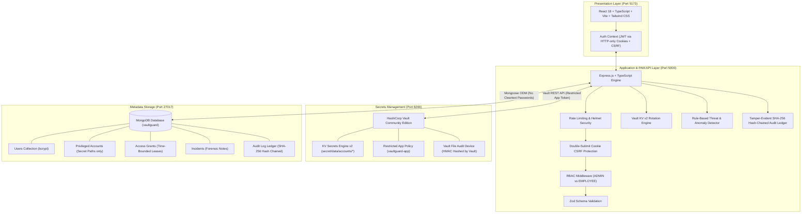
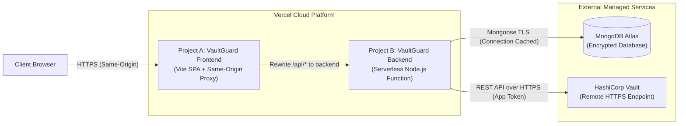

# VaultGuard – Privileged Access Management (PAM) System

> **Privileged Account Security & Access Governance Platform (Portfolio Project)**  
> *Secure Privileged Access. Maintain Complete Visibility.*

VaultGuard is a lightweight, local-first Privileged Access Management (PAM) application engineered to demonstrate practical knowledge of privileged account lifecycle management, hardware-grade secrets isolation with HashiCorp Vault KV v2, just-in-time (JIT) access request and approval governance, cryptographic credential rotation, Vault health telemetry, and tamper-evident audit logging with SHA-256 hash chaining.

The project models enterprise PAM design patterns inspired by enterprise platforms such as CyberArk (Digital Vault, CPM, PVWA governance workflows) without claiming to be a production CyberArk deployment.

---

## 1. System Architecture



---

## 2. Core Security & Architectural Principles

1. **Zero Cleartext Secret Persistence in MongoDB**:
   - The application database (`MongoDB`) strictly stores account metadata, ownership, target hostnames, and the Vault reference path (`accounts/acc_<id>`).
   - Plaintext passwords and Vault root tokens are **never** stored in MongoDB. Credentials (target username and decrypted password) are returned **strictly through the authorized, time-bounded credential checkout endpoint** (`POST /api/accounts/:id/retrieve`) upon verification of an active grant and approved access request. General account list, metadata, audit, and user profile endpoints never expose credentials.
2. **Fail-Closed Architecture**:
   - If HashiCorp Vault is unreachable, sealed, or reports degraded status, credential retrievals and account onboards **immediately fail closed** (returning HTTP 503). Under no circumstances are fallback plaintext stores used.
3. **Dual-Custody & Self-Approval Prevention**:
   - Administrators cannot approve their own privileged access requests. Approvals require an independent administrator review.
4. **Server-Enforced Access Grants**:
   - Temporary access grants expire automatically on the backend server. Even if a client bypasses UI timers, the server enforces strict timestamp and revocation checks before contacting Vault.
5. **Tamper-Evident SHA-256 Hash Chaining (Scope & Boundaries)**:
   - Application audit logs are cryptographically linked in a sequential SHA-256 hash chain from Genesis (`0000...0000`).
   - The mechanism is **tamper-evident** (not immutable or tamper-proof): any retroactive modification, reordering, or individual deletion breaks chain verification and is flagged by `GET /api/audit/verify`.
   - Complete chain rewriting or tail truncation cannot be detected without external cryptographic anchoring (e.g., public timestamping, external blockchain, or remote witness services).
   - Separate Vault Audit Device: HashiCorp Vault independently logs its own API interactions via a file audit device using internal HMAC hashing.
6. **Credential Redaction**:
   - The audit service automatically scrubs and redacts fields containing `password`, `token`, `secret`, `credential`, `hash`, `cookie`, `auth`, or `private` before recording events.

---

## 3. Technology Stack

- **Frontend**: React 18, TypeScript, Vite, Tailwind CSS, Lucide React, Axios, React Router v7.
- **Backend**: Node.js v24, Express 4, TypeScript, JWT (HTTP-Only Secure Cookies), bcrypt (10 rounds), Zod validation, Helmet, Express Rate Limit.
- **Database**: MongoDB 8.x with Mongoose ODM (strictly object references and schemas, bound to 127.0.0.1).
- **Secrets Engine**: HashiCorp Vault Community Edition (v1.15.6), KV Secrets Engine Version 2, custom ACL policy (`vaultguard-app`), file audit device (bound to 127.0.0.1).
- **Local Development**: Docker Compose & native services.

---

## 4. Synthetic Demonstration Identity & Roles

> **NOTE:** All users, hostnames, IP addresses (`10.0.x.x`), and credentials listed below are **synthetic demonstration data** for isolated local portfolio evaluation only.

| Role | Name | Email | Synthetic Demonstration Responsibility |
| :--- | :--- | :--- | :--- |
| **ADMIN** | Alexander Vance | `admin@vaultguard.local` | Principal Security Administrator: PAM governance, HashiCorp Vault management, approvals, credential rotation, forensic investigation |
| **EMPLOYEE** | Sarah Jenkins | `employee@vaultguard.local` | Senior Systems Engineer: Infrastructure operations, JIT access requests, authorized credential checkout |
| **EMPLOYEE** | David Kim | `developer@vaultguard.local` | Database Reliability Engineer: Scoped resource access, credential checkout |

---

## 5. Local Deployment & Execution Instructions

VaultGuard is built for **isolated, local-only execution on a Windows PC** using persistent storage for both MongoDB and HashiCorp Vault. Development mode (`-dev`) is retired in favor of **persistent integrated Raft storage** (`storage "raft"`) with cryptographic Shamir unsealing.

---

### Option A: Native Windows PowerShell Workflow (Recommended for Local PC)

This workflow runs HashiCorp Vault Community Edition (v1.15.6) natively via `bin\vault.exe` using `vault/config/vault-local.hcl` with persistent Raft storage in `vault/data/`. All services bind strictly to `127.0.0.1`.

#### Step 1: Start Persistent Vault Server
In an elevated or standard Windows PowerShell terminal:
```powershell
powershell -ExecutionPolicy Bypass -File .\vault\scripts\start-vault-persistent.ps1
```
*Vault launches in background with integrated Raft storage listening on `http://127.0.0.1:8200`.*

#### Step 2: Cryptographic Shamir Initialization (One-Time Setup)
Initialize the Vault security barrier with Shamir secret sharing (5 keys, threshold 3):
```powershell
powershell -ExecutionPolicy Bypass -File .\vault\scripts\init-vault-persistent.ps1
```
- Safely generates 5 unseal key shares and 1 root operator token.
- Automatically saves operator credentials to `vault/unseal-keys.json` (protected by `.gitignore`).
- Includes safety check: blocks re-initialization if Vault is already initialized.

#### Step 3: Unseal the Vault Server
Apply 3 of the 5 Shamir keys to unseal the storage barrier:
```powershell
powershell -ExecutionPolicy Bypass -File .\vault\scripts\unseal-vault.ps1
```
- Automatically uses keys from `vault/unseal-keys.json` or prompts interactively.
- Vault transitions from `Sealed: true` to `Active: true`.

#### Step 4: Provision Least-Privilege AppRole & KV v2 Engine
Configure VaultGuard policies, secrets engine, and AppRole credentials:
```powershell
powershell -ExecutionPolicy Bypass -File .\vault\scripts\configure-vaultguard-approle.ps1
```
- Enables KV v2 secrets engine at `secret/`.
- Registers least-privilege application policy `vaultguard-app` (`vault/policies/vaultguard-app-policy.hcl`).
- Enables HashiCorp Vault file audit logging to `vault/logs/vault_audit.log`.
- Configures AppRole `vaultguard-role` with 1-hour auto-renewing tokens.
- Generates `VAULT_ROLE_ID`, `VAULT_SECRET_ID`, and backup `VAULT_APP_TOKEN`.
- Automatically stages credentials into `backend/.env` without console credential leakage.

#### Step 5: Verify Persistent Raft Storage Across Server Restarts
Run the automated persistence verification test:
```powershell
powershell -ExecutionPolicy Bypass -File .\vault\scripts\verify-persistence.ps1
```
*Stores a test secret in KV v2, shuts down Vault, restarts the server, confirms Vault restarts SEALED with data intact, unseals with 3 keys, verifies the secret matches, and cleans up.*

#### Step 6: Start Application Backend and Frontend
In separate PowerShell terminals:
```powershell
# Terminal 1: Backend API (Port 5000)
cd backend
npm install
npm run seed     # Seeds synthetic demo accounts & users
npm run dev

# Terminal 2: Frontend Portal (Port 5173)
cd frontend
npm install
npm run dev
```

#### Stopping Vault Server
To gracefully stop all running local Vault processes:
```powershell
powershell -ExecutionPolicy Bypass -File .\vault\scripts\stop-vault-persistent.ps1
```

---

### Option B: Docker Compose Workflow (Persistent Raft Volume)

If Docker Desktop is installed, start containerized persistent Vault and MongoDB:
```bash
# 1. Copy environment template
cp .env.example .env

# 2. Start persistent MongoDB and Vault containers
docker compose up -d mongodb vault

# 3. Initialize Vault inside the container (if uninitialized)
docker compose exec vault vault operator init -key-shares=5 -key-threshold=3

# 4. Unseal Vault using 3 of the unseal keys
docker compose exec vault vault operator unseal <KEY_1>
docker compose exec vault vault operator unseal <KEY_2>
docker compose exec vault vault operator unseal <KEY_3>

# 5. Configure AppRole using root token
.\vault\scripts\configure-vaultguard-approle.ps1 -VaultRootToken "<ROOT_TOKEN>"

# 6. Start Application services
docker compose up -d backend frontend
```

---

## 6. Automated Verification Suite (36 Integration Scenarios)

The project includes an end-to-end integration test suite (`backend/src/tests/pam.test.ts`) covering all 36 security, governance, concurrency, and validation scenarios:

```bash
cd backend
npm test
```

### Verified Test Results (36 Passed, 0 Failed):
```text
============================================================
   VAULTGUARD PAM SYSTEM - AUTOMATED INTEGRATION TESTS      
============================================================

[Database] Connecting to MongoDB (mongodb://127.0.0.1:27017/vaultguard)...
[Database] MongoDB connection established successfully
[PASS] 1. Successful Login & Cookie-Only JWT Auth (Admin, Employee, Developer)
[PASS] 2. Invalid Login (Bad Credentials Rejected)
[PASS] 3. CSRF Protection (State-changing cookie request without X-CSRF-Token blocked)
[PASS] 4. Role-Based Access Control (Employee accessing admin-only endpoint blocked)
[PASS] 5. Account Onboarding (Metadata stored in MongoDB, credential in Vault KV v2)
[PASS] 6. Vault Secret Storage Verification (Credential verified directly in KV v2)
[PASS] 7. Unauthorized Credential Retrieval (Employee without active grant blocked)
[PASS] 8. Access Request Submission (Employee submits request with business justification)
[PASS] 9. Access Request Approval & Self-Approval Prevention
[PASS] 10. Authorized Credential Retrieval (Employee retrieves with active grant)
[PASS] 11. Access Request Rejection (Admin rejects request)
[PASS] 12. Expired Access Denial (Server-side expiry check fails closed)
[PASS] 13. Revoked Access Denial (Admin explicitly revokes grant)
[PASS] 14. Credential Rotation (Vault KV v2 secret rotated; Target OS honestly reported)
[PASS] 15. Tamper-Evident Audit Log Integrity Verification & Tamper Detection
[PASS] 16. Input Validation (Malformed ObjectIds return 400 Bad Request)
[PASS] 17. Vault Health Monitoring (Honest reporting on Vault service status)
[PASS] 18. Audit Log Zero-Password Redaction & Incident Management
[PASS] 19. Independent Audit Field Tampering Detection (userId & ipAddress)
[PASS] 20. Intra-Process Concurrency in Audit Logging (Parallel writes in single Node process preserve chain)
[PASS] 21. Audit Persistence Failure & Observable Error Propagation
[PASS] 22. Access Request Review Input Validation (Invalid body rejected with 400)
[PASS] 23. Concurrent Approval Conflict Handling (Atomic state transition)
[PASS] 24. Approval State-Transition Compensation Rollback on Grant Failure
[PASS] 25. Real Monitoring Metadata (Actual Vault telemetry returned)
[PASS] 26. Audit Failure During Approval Triggers Compensation Rollback
[PASS] 27. Rollback Failure Triggers Critical Security Incident & Fails Closed
[PASS] 28. Orphan Grant Rejection (Credential checkout denied if request is not Approved)
[PASS] 29. Production Health Checks (Liveness vs Dependency Readiness)
[PASS] 30. Vault AppRole Authentication & Token Renewal Engine
[PASS] 31. Vault AppRole Token Expiry & Failure Handling
[PASS] 32. Vercel Serverless Function Handler Compatibility (All HTTP Methods & Proxy Features)
[PASS] 33. Authenticated Session Refresh (/api/auth/refresh) & Logout Flow
[PASS] 34. Comprehensive Vercel Serverless Routing Matrix (All Key Endpoints Verified)
[PASS] 35. AppRole Expired SecretID Failure Handling & Zero-Credential Leakage
[PASS] 36. Database Dependency Readiness Failure Handling (503 on DB Outage)

------------------------------------------------------------
SUMMARY: 36 PASSED, 0 FAILED out of 36 tests.
------------------------------------------------------------
```

---

## 7. Operational Workflow Scenarios

### SCENARIO 1: Administrator Registers a Privileged Account
1. Sign in as Administrator (`admin@vaultguard.local` / `AdminPassword!2026`).
2. Navigate to **Credential Vault** and select **Onboard Privileged Account**.
3. Register the target account (e.g. `PROD-DC01-AD`, `corp.admin`, `Windows Administrator`, `10.0.10.15`).
4. Confirm that the account appears in the inventory table. Inspect MongoDB to confirm that only `vaultSecretPath` is stored—the actual password resides strictly within HashiCorp Vault KV v2.

### SCENARIO 2: Systems Engineer Requests Privileged Access
1. Sign in as Systems Engineer (`employee@vaultguard.local` / `EmployeePassword!2026`).
2. Navigate to **Credential Vault**.
3. Select an ungranted asset (e.g. `K8S-MASTER-CORE01`) and select **Request Access**.
4. Enter business justification: *"RFC-2026-4412: Urgent mitigation of OpenSSL vulnerability CVE-2026-2184 on production master node"* and select **60 minutes**.
5. Submit the request. Navigate to **Access Requests** to verify status: `Pending Review`.

### SCENARIO 3: Administrator Approves Request & Enforces Dual Custody
1. Log back in as Administrator (`admin@vaultguard.local`).
2. Navigate to **Access Requests**. View Sarah Jenkins's request.
3. Select **Approve**, enter reviewer comment, and confirm.
4. Verify that self-approval is rejected if the administrator attempts to approve an account they requested themselves.

### SCENARIO 4: Systems Engineer Retrieves Authorized Credential
1. Switch back to Sarah Jenkins (`employee@vaultguard.local`).
2. In **Credential Vault**, the action button has updated to **Check Out**.
3. Select **Check Out**. The **Privileged Credential Retrieval Modal** opens:
   - Displays live credential decrypted from Vault KV v2.
   - Shows active grant expiration timestamp.
   - Active 60-second auto-clearing memory timer.
   - One-click copy with clipboard clearing.

### SCENARIO 5: Unauthorized Access Denied
1. Sign in as Developer (`developer@vaultguard.local` / `DevPassword!2026`).
2. Attempt direct checkout or API call on `PROD-DC01-AD`.
3. The server rejects the attempt with HTTP 403: *"Access Denied: You do not have an approved access grant for this privileged account."*
4. Confirm that an audit denial record is immediately written to the audit log.

### SCENARIO 6: Audit Logs Record Complete Trail
1. Sign in as Administrator.
2. Navigate to **Audit Logs**.
3. Inspect immutable log entries for: Login, Account Onboarding, Access Request, Approval, Credential Retrieved, and Credential Retrieval Denied.
4. Select **Export CSV Report** to download the compliance audit ledger.

### SCENARIO 7: Administrator Investigates Security Incident
1. Select **Incidents**.
2. Open an incident flagged by the rule-based detection engine (e.g. repeated unauthorized retrieval attempts or rotation failure).
3. Select **Investigate**. Add forensic notes to the incident timeline.
4. Enter remediation summary and select **Resolve & Close Incident**.

### SCENARIO 8: Cryptographic Credential Rotation
1. Navigate to **Credential Rotation**.
2. Select target account `PROD-DC01-AD` and select **Execute Rotation**.
3. The system generates a 24-character high-entropy cryptographic password, writes a new version to HashiCorp Vault KV v2, verifies the secret, and logs the reconciliation record.
4. Enable **"Enforce strict host agent verification"** to demonstrate failure handling and automated incident creation.

### SCENARIO 9: Vault Health & Seal Status
1. Navigate to **Monitoring**.
2. Inspect live telemetry: Shamir seal status, restricted app token validity, physical audit log file size, and 24-hour access attempt rates.
3. Select **Poll Health Now** to verify real-time responsiveness.

---

## 8. API Specification

| Method | Endpoint | Role | Description |
| :--- | :--- | :--- | :--- |
| `POST` | `/api/auth/login` | Public | Authenticates user and issues HTTP-only cookie + JWT |
| `POST` | `/api/auth/refresh` | Authenticated | Extends active session and rotates CSRF token |
| `POST` | `/api/auth/logout` | Authenticated | Clears session cookie and records audit log |
| `GET` | `/api/auth/me` | Authenticated | Returns current authenticated profile and role |
| `GET` | `/api/health/live` | Public | Container liveness probe (Node/Express process check) |
| `GET` | `/api/health/ready` | Public | Dependency readiness probe (pings MongoDB & Vault) |
| `GET` | `/api/health` | Public | Comprehensive health probe (defaults to readiness) |
| `GET` | `/api/accounts` | Authenticated | Lists privileged accounts (metadata only) |
| `POST` | `/api/accounts` | ADMIN | Onboards account & writes secret to Vault KV v2 |
| `GET` | `/api/accounts/:id` | Authenticated | Retrieves account metadata |
| `PUT` | `/api/accounts/:id` | ADMIN | Updates account metadata (or updates Vault password) |
| `DELETE` | `/api/accounts/:id` | ADMIN | Deletes metadata and purges Vault secret |
| `POST` | `/api/accounts/:id/retrieve` | Authenticated | Validates active grant and retrieves secret from Vault |
| `POST` | `/api/requests` | Authenticated | Submits just-in-time access request |
| `GET` | `/api/requests` | ADMIN | Lists all access requests |
| `GET` | `/api/requests/my` | Authenticated | Lists requester's access requests and active grants |
| `PATCH` | `/api/requests/:id/approve` | ADMIN | Approves request and creates timed `AccessGrant` |
| `PATCH` | `/api/requests/:id/reject` | ADMIN | Rejects access request with explanation |
| `PATCH` | `/api/requests/:id/revoke` | ADMIN | Immediately revokes active access grant |
| `POST` | `/api/rotation/:accountId` | ADMIN | Rotates credential in Vault and reconciles |
| `GET` | `/api/rotation/history` | ADMIN | Returns rotation history records |
| `GET` | `/api/monitoring/vault-health` | ADMIN | Live Vault engine health, seal status & telemetry |
| `GET` | `/api/monitoring/events` | ADMIN | Recent security denial and error events |
| `GET` | `/api/incidents` | ADMIN | Queries security incidents |
| `POST` | `/api/incidents` | ADMIN | Registers manual security incident |
| `PATCH` | `/api/incidents/:id` | ADMIN | Appends notes and updates incident severity |
| `PATCH` | `/api/incidents/:id/resolve` | ADMIN | Resolves security incident with remediation notes |
| `GET` | `/api/audit` | ADMIN | Filtered audit query |
| `GET` | `/api/audit/verify` | ADMIN | Cryptographic SHA-256 hash chain integrity verification |
| `GET` | `/api/audit/export` | ADMIN | Exports audit ledger to CSV format |
| `GET` | `/api/dashboard/summary` | Authenticated | Computes high-level PAM KPIs from live database |
| `GET` | `/api/dashboard/recent-activity` | Authenticated | Fetches recent audit events and open incidents |

---

## 9. Implementation Scope & Architectural Limitations

1. **Vault Secret Rotation vs. Target OS Reconciliation**:
   - **Implemented**: VaultGuard generates cryptographically secure 32-character passwords, writes new secret versions to HashiCorp Vault KV v2, verifies the secret write, and records rotation history.
   - **Out of Scope (Honest Disclosure)**: VaultGuard does not deploy local host agents or establish remote network connections (SSH/WMI/RPC/LDAP) to change passwords directly on target Windows Domain Controllers or Linux hosts. The application explicitly flags `targetStatus: 'NOT_IMPLEMENTED'` and `targetPasswordChanged: false`.
2. **Audit Hash Chain Scope**:
   - The SHA-256 hash chaining mechanism provides robust tamper-evidence for historical records stored in the application database. An attacker or malicious administrator cannot alter, reorder, or delete past audit logs without breaking the chain.
   - It is an application-level hash chain; it does not replace distributed Byzantine consensus or write-once optical media (WORM storage). For independent operational logging, HashiCorp Vault's file audit device records HMAC-hashed API events to `/vault/logs/vault_audit.log`.
3. **Database Concurrency & Transactions**:
   - State transitions (such as access approvals) use atomic MongoDB operations (`findOneAndUpdate` with state checks) and compensation rollbacks. In standalone local MongoDB instances (without a replica set), multi-document ACID transactions are not enabled; the application employs automatic compensation logic to revert request states if grant issuance or audit logging fails.
4. **Local-First & Serverless Deployment Readiness**:
   - Designed for local execution, portfolio demonstration, and security evaluation via Docker or native services, and fully prepared for production serverless deployment on Vercel using two decoupled projects (Frontend SPA and Serverless Express API) communicating over a same-origin reverse proxy.

---

## 10. Vercel Deployment Guide (Serverless Architecture)

VaultGuard is pre-configured for seamless production deployment on **Vercel** as two decoupled projects originating from the same GitHub repository (`https://github.com/Adarsh048/VaultGuard`).

### 10.1 Architecture Overview



- **Same-Origin API Proxy**: `frontend/vercel.json` proxies all `/api/:path*` requests directly to the deployed backend URL. This ensures `SameSite=Lax` and `HttpOnly` security cookies (`vaultguard_token`, `vaultguard_csrf`) are set on the frontend domain without third-party cookie restrictions or cross-origin issues.
- **Serverless Connection Caching**: `backend/src/config/database.ts` uses a global Mongoose connection cache (`global.mongooseCache`) to reuse active database sockets across warm lambda invocations and prevent connection exhaustion on MongoDB Atlas.
- **Fail-Closed Production Guardrails**: `backend/src/config/env.ts` enforces non-localhost Atlas URIs, strictly HTTPS Vault endpoints, minimum 32-character JWT secrets, and prohibits synthetic data seeding in production.

---

### 10.2 External Services Setup (Prerequisites & Network Security)

#### 1. MongoDB Atlas Setup & Network Access Control

> [!WARNING]
> **Enterprise Security Warning on IP Allowlisting (`0.0.0.0/0`)**:
> Opening MongoDB Atlas to `0.0.0.0/0` (Anywhere) allows connection attempts to port 27017 from the public internet. This must **never** be used in enterprise production environments.

##### Production Network Allowlisting Strategies (Vercel Outbound IPs)
Standard Vercel Serverless Functions execute on dynamic multi-tenant AWS Lambda pools with rotating outbound IP addresses. For production environments, employ one of the following architectures:

1. **Vercel Secure Compute (Recommended for Enterprise)**:
   - Assigns dedicated egress IP addresses and dedicated VPC networking to Vercel projects.
   - Add the provisioned static egress IPs directly to the MongoDB Atlas **Network Access** IP Access List.
2. **Static Egress Proxy**:
   - Route outbound database connections through a dedicated static NAT proxy (e.g. QuotaGuard Static or an AWS NAT Gateway).
   - Allowlist only the proxy's fixed static IP addresses in Atlas.
3. **AWS VPC Peering / AWS PrivateLink**:
   - If hosting on a dedicated Atlas tier (M10+) and AWS infrastructure, configure VPC Peering or AWS PrivateLink to keep all traffic private without public IP traversal.

##### Temporary Demo-Only Alternative (Portfolio / Evaluation Setup)
If evaluating this project on free/hobby tiers where dedicated static egress IPs are unavailable:
- You may temporarily permit access in **Network Access** (`0.0.0.0/0`) for the duration of the evaluation.
- **Mandatory Compensating Controls**:
  - Enforce SCRAM-SHA-256 database authentication with a $\ge 32$-character high-entropy cryptographic password.
  - Create a least-privilege database user restricted strictly to `readWrite` on the `vaultguard` database (zero `dbAdmin`, `clusterAdmin`, or `atlasAdmin` permissions).
  - Enable MongoDB Atlas multi-factor authentication (MFA) on all administrator accounts.
  - Remove `0.0.0.0/0` immediately after evaluation concludes.

Copy the Atlas SRV connection string:
```text
mongodb+srv://<username>:<password>@cluster0.xxxx.mongodb.net/vaultguard?retryWrites=true&w=majority
```

---

#### 2. Remote HashiCorp Vault Setup (AppRole Authentication)

Because HashiCorp Vault is a persistent cryptographic service, it must run on a persistent HTTPS endpoint (e.g. [HashiCorp Cloud Platform (HCP) Vault](https://cloud.hashicorp.com/products/vault), Fly.io, Railway, or a hardened VPS with TLS).

##### Step A: Enable AppRole Authentication (Serverless-Compatible)
Serverless functions spin down and freeze execution context, making long-lived static tokens vulnerable to silent expiration without background renewal. VaultGuard implements **Vault AppRole Authentication** with short-lived (1-hour) tokens, automated proactive renewal, and re-authentication on expiration.

1. Ensure Vault has KV v2 enabled at `secret/`.
2. Apply the `vaultguard-app` policy (`vault/policies/vaultguard-app-policy.hcl`):
   ```bash
   vault policy write vaultguard-app vault/policies/vaultguard-app-policy.hcl
   ```
3. Enable the AppRole auth method:
   ```bash
   vault auth enable approle
   ```
4. Configure the `vaultguard-role`:
   ```bash
   vault write auth/approle/role/vaultguard-role \
     token_policies="vaultguard-app" \
     token_ttl="1h" \
     token_max_ttl="24h" \
     secret_id_ttl="720h"
   ```
5. Retrieve the static `role_id`:
   ```bash
   vault read -field=role_id auth/approle/role/vaultguard-role/role-id
   ```
6. Mint a `secret_id` (record securely; never commit or expose to frontend):
   ```bash
   vault write -f -field=secret_id auth/approle/role/vaultguard-role/secret-id
   ```

##### Step B: AppRole SecretID Lifecycle & Zero-Downtime Rotation Procedure

> [!IMPORTANT]
> **Operational Disclosure on SecretID Expiration**:
> In the standard configuration, `secret_id_ttl` is set to `720h` (30 days). **When the SecretID expires after 30 days, any serverless instance performing an authentication cold start will be rejected by Vault (`400 Bad Request: invalid role or secret ID`) and fail closed.** VaultGuard does **not** claim automated SecretID rotation, as rotating an external root credential requires an external secrets orchestrator.

To execute a **Zero-Downtime SecretID Rotation** before the 30-day window closes:

1. **Mint New SecretID**:
   Execute the included rotation helper script:
   ```bash
   ./vault/scripts/rotate-secret-id.sh "$VAULT_ADMIN_TOKEN"
   # Or on Windows PowerShell:
   .\vault\scripts\rotate-secret-id.ps1 -VaultRootToken "$VAULT_ADMIN_TOKEN"
   ```
   Vault allows multiple active SecretIDs for the same role simultaneously. Both old and new SecretIDs remain valid during the rotation window.
2. **Update Vercel Environment Variables**:
   - Navigate to **Vercel Dashboard** -> Project `vaultguard-api` -> **Settings** -> **Environment Variables**.
   - Edit `VAULT_SECRET_ID` and replace it with the newly generated SecretID.
   - Alternatively via Vercel CLI:
     ```bash
     printf '%s' "<NEW_SECRET_ID>" | vercel env add VAULT_SECRET_ID production
     ```
3. **Trigger Redeployment**:
   - Redeploy the backend project in Vercel so all incoming serverless containers pick up the updated `VAULT_SECRET_ID`.
4. **Destroy Old SecretID**:
   - List existing accessors:
     ```bash
     vault list auth/approle/role/vaultguard-role/secret-id
     ```
   - Destroy the retired SecretID accessor:
     ```bash
     vault write auth/approle/role/vaultguard-role/secret-id-accessor/destroy secret_id_accessor="<OLD_ACCESSOR>"
     ```

*(Alternative for persistent evaluation environments: set `secret_id_ttl=0` during role creation for a non-expiring SecretID that remains valid until manually destroyed).*

##### Alternative (Static Token Fallback)
For local development or persistent container environments, you may alternatively generate a periodic token:
```bash
vault token create -policy=vaultguard-app -period=720h -orphan -display-name="vaultguard-prod-api"
```
> [!NOTE]
> In serverless production, **AppRole authentication (`VAULT_ROLE_ID` and `VAULT_SECRET_ID`) is strongly recommended**. If a periodic token is used without an active daemon process to renew it, it will expire after 720 hours of inactivity.

---

### 10.3 Project Deployment on Vercel

Import the repository (`https://github.com/Adarsh048/VaultGuard`) twice in the [Vercel Dashboard](https://vercel.com/new).

#### Step 1: Deploy Backend (Project B)
1. In Vercel, select **Add New Project** and choose `VaultGuard`.
2. Configure **Project Settings**:
   - **Project Name**: `vaultguard-api` (or preferred name)
   - **Root Directory**: Click *Edit* and select `backend`
   - **Framework Preset**: `Other`
   - **Build Command**: *(leave empty / default)*
   - **Output Directory**: *(leave empty / default)*
3. Configure **Environment Variables**:
   | Variable | Value | Description |
   | :--- | :--- | :--- |
   | `NODE_ENV` | `production` | Enables strict production security mode |
   | `JWT_SECRET` | *(Random 32+ character string)* | Signs and verifies user authentication tokens |
   | `JWT_EXPIRES_IN` | `8h` | Token expiration duration |
   | `MONGO_URI` | `mongodb+srv://...` | MongoDB Atlas remote connection string |
   | `VAULT_ADDR` | `https://vault.yourdomain.com:8200` | Remote HTTPS HashiCorp Vault address |
   | `VAULT_ROLE_ID` | `<approle-role-id>` | **(Recommended)** AppRole Role ID for auto-renewing tokens |
   | `VAULT_SECRET_ID` | `<approle-secret-id>` | **(Recommended)** AppRole Secret ID |
   | `VAULT_APP_TOKEN` | `<restricted-app-token>` | *(Fallback if AppRole not used)* |
   | `VAULT_KV_MOUNT` | `secret` | Vault KV v2 mount path |
   | `CORS_ORIGIN` | `https://vaultguard-web.vercel.app` | Frontend production origin (update after Step 2) |
   | `COOKIE_SAMESITE` | `lax` | Cookie SameSite attribute |
4. Click **Deploy**. Note the assigned backend URL (e.g., `https://vaultguard-api.vercel.app`).

---

#### Step 2: Deploy Frontend (Project A)
1. In `frontend/vercel.json`, update the rewrite destination URL with your deployed backend address:
   ```json
   {
     "rewrites": [
       {
         "source": "/api/:path*",
         "destination": "https://vaultguard-api.vercel.app/api/:path*"
       },
       {
         "source": "/(.*)",
         "destination": "/index.html"
       }
     ]
   }
   ```
2. In Vercel, select **Add New Project** and choose `VaultGuard`.
3. Configure **Project Settings**:
   - **Project Name**: `vaultguard-web`
   - **Root Directory**: Click *Edit* and select `frontend`
   - **Framework Preset**: `Vite`
   - **Build Command**: `npm run build`
   - **Output Directory**: `dist`
4. Configure **Environment Variables**:
   *(No required variables: the frontend communicates with `/api` through the same-origin Vercel rewrite proxy).*
5. Click **Deploy**. Note the assigned frontend URL (e.g., `https://vaultguard-web.vercel.app`).
6. *(Post-Deployment Alignment)*: Return to Project B (**vaultguard-api**) -> **Settings** -> **Environment Variables**, ensure `CORS_ORIGIN` matches your production frontend URL (`https://vaultguard-web.vercel.app`), and redeploy if needed.

---

### 10.4 Production Health Checks & Monitoring Probes

VaultGuard separates process liveness from external dependency readiness:

1. **Liveness Probe (`GET /api/health/live`)**:
   - Verifies the Node.js / Express serverless container is alive and responding to event loops.
   - Returns HTTP 200:
     ```json
     { "status": "UP", "check": "liveness", "uptimeSeconds": 142, "service": "VaultGuard PAM API" }
     ```
2. **Readiness Probe (`GET /api/health/ready` or `GET /api/health`)**:
   - Actively probes MongoDB connectivity (`ping` command) and HashiCorp Vault health (`/v1/sys/health`).
   - If all dependencies are healthy, returns HTTP 200:
     ```json
     {
       "status": "UP",
       "check": "readiness",
       "service": "VaultGuard PAM API",
       "dependencies": {
         "database": { "status": "UP", "type": "MongoDB", "connected": true, "latencyMs": 4 },
         "vault": { "status": "UP", "initialized": true, "sealed": false, "version": "1.15.6", "latencyMs": 7 }
       }
     }
     ```
   - If MongoDB is disconnected or Vault is sealed/unreachable, **returns HTTP 503 (Service Unavailable)** with honest dependency breakdown so external monitoring alerts immediately.

---

### 10.5 Serverless Rate Limiting Architecture & Limitations

- **In-Memory Rate Limiting as an Intra-Container Circuit Breaker**:
  - `express-rate-limit` maintains counters in memory. In serverless execution, each concurrent Lambda/Vercel instance maintains its own isolated memory space.
  - Counters are isolated to each individual container and reset when containers spin down.
  - This effectively serves as an **intra-container circuit breaker** that halts localized CPU/memory denial-of-service and rapid brute-force loops within a single container.
- **Enterprise Distributed Rate Limiting**:
  - For globally synchronized rate limiting across multi-region serverless instances, rate limiting should be deployed at the network edge via **Vercel Firewall / WAF custom rules** or **Cloudflare Rate Limiting**, or backed by an external distributed Redis store (e.g. Upstash Redis).
  - To avoid introducing unnecessary infrastructure dependencies to a portfolio project, edge rate limiting remains an operational gateway consideration.

---

### 10.6 Deployment Verification Matrix

| Verification Area | Local / Preview Status | Production Cloud Status |
| :--- | :--- | :--- |
| **Frontend Production Build** | Verified (`tsc && vite build` $\to$ `dist/` 0 errors) | Ready for Vercel deployment |
| **Backend Production Build** | Verified (`tsc` $\to$ `dist/` 0 errors) | Ready for Vercel deployment |
| **PAM Integration Suite** | Verified (36 / 36 tests passed) | Full functional & failure test suite validated |
| **Vercel Serverless Routing Matrix** | Verified (`/api/auth/*`, `/api/health/*`, `/api/accounts`, `/api/requests`, `/api/audit`) | Paths, verbs, query params, cookies compatible |
| **Vault AppRole Lifecycle** | Verified (Token acquisition, KV read/write, proactive renewal, expiry auto-refresh) | Requires remote Vault endpoint with AppRole |
| **Zero-Downtime SecretID Rotation** | Verified (`vault/scripts/rotate-secret-id.sh` & `.ps1`) | Manual/CI operational procedure documented |
| **Health Checks (Live vs Ready)** | Verified (200 on healthy; 503 on database or Vault outage) | Ready for external uptime monitoring |
| **Database Connection Caching** | Verified (`global.mongooseCache` prevents connection storms) | Requires MongoDB Atlas SRV URI |
| **Live Vercel Deployment** | Pending user deployment initiation | Step-by-step instructions provided |

---

## 11. 3-Minute Technical Interview Demonstration Guide

This structured demonstration playbook is engineered specifically for technical interviews, security architecture reviews, and hiring manager presentations. It highlights enterprise Privileged Access Management (PAM) concepts, secrets lifecycle management, defensive error handling, and cryptographic auditing in **exactly 3 minutes**.

### 11.1 Pre-Interview Setup Checklist
Before starting the call or screen share, ensure all local services are active:
```powershell
# 1. Verify Vault is unsealed and active
powershell -ExecutionPolicy Bypass -File .\vault\scripts\unseal-vault.ps1

# 2. Verify MongoDB is running locally
mongosh --eval "db.adminCommand('ping')"

# 3. Ensure Backend (port 5000) and Frontend (port 5173) are running
# Navigate to http://localhost:5173 in browser
```

---

### 11.2 Demonstration Script & Timing Breakdown

#### ⏱️ Part 1: Architecture & Secrets Isolation (0:00 – 0:45)
1. **Show the Login Screen & Architecture (`http://localhost:5173`)**:
   - Log in as **Alexander Vance** (`admin@vaultguard.local` / `AdminPassword!2026`).
   - *Talking Point*: *"VaultGuard is a PAM architecture modeled after enterprise solutions like CyberArk. It strictly isolates privileged credentials from application metadata."*
2. **Demonstrate Zero Cleartext Passwords in MongoDB**:
   - Click **Credential Vault**. Point out the registered infrastructure assets (`PROD-DC01-AD`, `K8S-MASTER-CORE01`, etc.).
   - *Talking Point*: *"MongoDB strictly stores resource metadata and a Vault reference path (`secret/data/accounts/acc_*`). The database never sees or stores plaintext passwords."*
3. **Highlight HashiCorp Vault Persistent Raft Storage**:
   - *Talking Point*: *"Under the hood, we are running HashiCorp Vault Community Edition with integrated Raft storage and Shamir secret sharing (3-of-5 threshold). The backend accesses Vault using a least-privilege AppRole with short-lived auto-renewing tokens."*

#### ⏱️ Part 2: Just-In-Time (JIT) Dual-Custody Governance (0:45 – 1:45)
1. **Switch to Requester (Sarah Jenkins)**:
   - In an incognito window or separate browser tab, log in as `employee@vaultguard.local` (`EmployeePassword!2026`).
   - Navigate to **Credential Vault**. Attempt to retrieve `PROD-DC01-AD`.
   - Point out that credential access is blocked without an active grant.
2. **Submit Just-In-Time (JIT) Access Request**:
   - Click **Request Access** on `K8S-MASTER-CORE01`.
   - Enter business justification: *"Emergency CVE mitigation on cluster master"* and select duration: **60 minutes**. Submit.
3. **Enforce Dual-Custody Approval (Admin Screen)**:
   - Switch back to Admin window -> **Access Requests**.
   - Point out: *"Administrators cannot self-approve their own requests (dual-custody enforcement)."*
   - Review Sarah's request, approve it with a review comment.
4. **Authorized Credential Checkout**:
   - Switch back to Sarah's window. The status immediately updates to **Active Grant**.
   - Click **Check Out Credential**.
   - Point out the **in-memory retrieval modal**:
     - Credential decrypted on-demand from Vault KV v2.
     - 60-second auto-clearing memory timer.
     - Clipboard copy with auto-clear.

#### ⏱️ Part 3: Cryptographic Rotation & Incident Detection (1:45 – 2:30)
1. **Execute Vault KV v2 Secret Rotation**:
   - In Admin window, navigate to **Credential Rotation**.
   - Select `PROD-DC01-AD` and click **Execute Rotation**.
   - Point out: The backend generates a 32-character high-entropy cryptographic password, writes a new version directly to Vault KV v2, verifies the write, and updates rotation history.
   - Point out the honest target status: Target host OS agent is reported as simulated (see Disclosure 3).
2. **Incident Management & Forensics**:
   - Navigate to **Incidents**.
   - Show how anomalous behavior (repeated denied checkouts or rotation anomalies) automatically triggers rule-based security incidents.
   - Open an incident, append forensic investigation notes, and resolve it.

#### ⏱️ Part 4: Tamper-Evident SHA-256 Audit Ledger & Live Telemetry (2:30 – 3:00)
1. **Verify Audit Hash Chain Integrity**:
   - Navigate to **Audit Logs**.
   - Point out the complete, zero-redacted operational audit trail.
   - Click **Verify Hash Chain Integrity**. The system walks the entire SHA-256 ledger from Genesis (`0000...0000`) and reports `INTEGRITY_VERIFIED: All records cryptographically intact`.
2. **Inspect Live Vault Telemetry**:
   - Navigate to **Monitoring**.
   - Point out live Vault telemetry: Shamir seal status (`Sealed: false`), AppRole token lease, storage engine (`raft`), physical audit device status, and fail-closed readiness checks.
   - *Closing Statement*: *"VaultGuard demonstrates that enterprise PAM security principles—least-privilege access, zero cleartext secret storage, dual-custody governance, and cryptographic auditing—can be practically implemented with modern full-stack technologies."*

---

### 11.3 Mandatory Technical Disclosures (Proactive Interview Transparency)

To maintain absolute professional integrity during technical interviews and architecture evaluations, proactively disclose the following architectural boundaries:

1. **Local-Only Demonstration Environment**:
   - VaultGuard is currently running in a local environment on this Windows PC (native MongoDB on port 27017, persistent HashiCorp Vault on port 8200, Node.js on port 5000, and React on port 5173). It does not require or depend on external cloud hosting for evaluation.
2. **Synthetic Demonstration Data**:
   - All user identities (Alexander Vance, Sarah Jenkins, David Kim), hostnames (`PROD-DC01-AD`), IP addresses (`10.0.10.x`), and credentials are **synthetic fixtures** seeded for local portfolio demonstration only. No production or real infrastructure is targeted.
3. **Target Host OS Credential Rotation Scope**:
   - The application fully implements and cryptographically verifies HashiCorp Vault KV v2 secret rotation and versioning.
   - However, VaultGuard does **not** deploy native host agents or execute remote RPC/WMI/SSH commands to manipulate passwords on physical target Windows Domain Controllers or Linux instances. The API and UI explicitly report `targetStatus: 'NOT_IMPLEMENTED'` and `targetPasswordChanged: false`.
4. **Audit Hash Chain Scope & Boundaries**:
   - The SHA-256 hash chaining mechanism provides application-level tamper evidence within the database ledger. Any retroactive record modification, reordering, or individual deletion breaks the chain and is detected by `GET /api/audit/verify`.
   - It is not an immutable distributed blockchain or WORM optical storage; an attacker with full root database access who rewrites the entire chain from Genesis could forge it without external cryptographic time-stamping. HashiCorp Vault's independent HMAC file audit device (`vault_audit.log`) serves as the secondary operational record.
5. **AppRole SecretID Lifecycle & Rotation**:
   - In production environments, AppRole SecretIDs carry a 30-day (`720h`) time-to-live. VaultGuard provides zero-downtime rotation scripts (`rotate-secret-id.ps1` / `.sh`) allowing operators to mint a new SecretID and update environment variables before the old SecretID expires.

