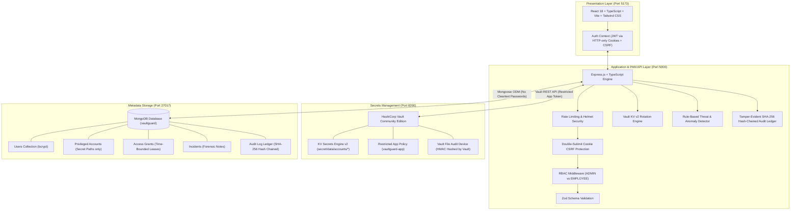

# VaultGuard – Privileged Access Management (PAM) System

> **Privileged Account Security & Access Governance Platform (Portfolio Project)**  
> *Secure Privileged Access. Maintain Complete Visibility.*

VaultGuard is a lightweight, local-first Privileged Access Management (PAM) application engineered to demonstrate practical knowledge of privileged account lifecycle management, hardware-grade secrets isolation with HashiCorp Vault KV v2, just-in-time (JIT) access request and approval governance, cryptographic credential rotation, Vault health telemetry, and tamper-evident audit logging with SHA-256 hash chaining.

The project models enterprise PAM design patterns inspired by enterprise platforms such as CyberArk (Digital Vault, CPM, PVWA governance workflows) without claiming to be a production CyberArk deployment.

---

## 1. System Architecture



---

## 2. Core Security & Architectural Principles

1. **Zero Cleartext Secret Persistence in MongoDB**:
   - The application database (`MongoDB`) strictly stores account metadata, ownership, target hostnames, and the Vault reference path (`accounts/acc_<id>`).
   - Plaintext passwords and Vault root tokens are **never** stored in MongoDB or exposed in API responses.
2. **Fail-Closed Architecture**:
   - If HashiCorp Vault is unreachable, sealed, or reports degraded status, credential retrievals and account onboards **immediately fail closed** (returning HTTP 503). Under no circumstances are fallback plaintext stores used.
3. **Dual-Custody & Self-Approval Prevention**:
   - Administrators cannot approve their own privileged access requests. Approvals require an independent administrator review.
4. **Server-Enforced Access Grants**:
   - Temporary access grants expire automatically on the backend server. Even if a client bypasses UI timers, the server enforces strict timestamp and revocation checks before contacting Vault.
5. **Tamper-Evident SHA-256 Hash Chaining**:
   - Application audit logs are cryptographically linked in a sequential SHA-256 hash chain from Genesis (`0000...0000`). Modifying or deleting any historical log breaks verification.
   - Separate Vault Audit Device: HashiCorp Vault independently logs its own API interactions via a file audit device using internal HMAC hashing.
6. **Credential Redaction**:
   - The audit service automatically scrubs and redacts fields containing `password`, `token`, `secret`, `credential`, `hash`, `cookie`, `auth`, or `private` before recording events.

---

## 3. Technology Stack

- **Frontend**: React 18, TypeScript, Vite, Tailwind CSS, Lucide React, Axios, React Router v7.
- **Backend**: Node.js v24, Express 4, TypeScript, JWT (HTTP-Only Secure Cookies), bcrypt (10 rounds), Zod validation, Helmet, Express Rate Limit.
- **Database**: MongoDB 8.x with Mongoose ODM (strictly object references and schemas).
- **Secrets Engine**: HashiCorp Vault Community Edition (v1.15.6), KV Secrets Engine Version 2, custom ACL policy (`vaultguard-app`), file audit device.
- **Local Development**: Docker Compose & native Windows services.

---

## 4. Production Identity & Roles

| Role | Name | Email | Corporate Responsibility |
| :--- | :--- | :--- | :--- |
| **ADMIN** | Alexander Vance | `admin@vaultguard.local` | Principal Security Administrator: PAM governance, HashiCorp Vault management, approvals, credential rotation, forensic investigation |
| **EMPLOYEE** | Sarah Jenkins | `employee@vaultguard.local` | Senior Systems Engineer: Infrastructure operations, JIT access requests, authorized credential checkout |
| **EMPLOYEE** | David Kim | `developer@vaultguard.local` | Database Reliability Engineer: Scoped resource access, credential checkout |

---

## 5. Deployment & Execution Instructions

### Option A: Using Docker Compose
```bash
# Start MongoDB and HashiCorp Vault
docker compose up -d

# Initialize Vault policy and audit device
./vault/scripts/init-vault.sh

# Install & start Backend
cd backend
npm install
npm run seed
npm run dev

# In a separate terminal, install & start Frontend
cd ../frontend
npm install
npm run dev
```

### Option B: Native Services (Currently Running on this Host)
- **MongoDB**: Running on `mongodb://127.0.0.1:27017/vaultguard`
- **HashiCorp Vault**: Running on `http://127.0.0.1:8200`
- **Backend API**: Running on `http://localhost:5000`
- **Frontend Portal**: Running on `http://localhost:5173`

---

## 6. Automated Verification Suite (25 Integration Scenarios)

The project includes an end-to-end integration test suite (`backend/src/tests/pam.test.ts`) covering all 25 security, governance, concurrency, and validation scenarios:

```bash
cd backend
npm test
```

### Verified Test Results:
```text
============================================================
   VAULTGUARD PAM SYSTEM - AUTOMATED INTEGRATION TESTS      
============================================================

[Database] MongoDB connected successfully to mongodb://127.0.0.1:27017/vaultguard
[PASS] 1. Successful Login & Cookie-Only JWT Auth (Admin, Employee, Developer)
[PASS] 2. Invalid Login (Bad Credentials Rejected)
[PASS] 3. CSRF Protection (State-changing cookie request without X-CSRF-Token blocked)
[PASS] 4. Role-Based Access Control (Employee accessing admin-only endpoint blocked)
[PASS] 5. Account Onboarding (Metadata stored in MongoDB, credential in Vault KV v2)
[PASS] 6. Vault Secret Storage Verification (Credential verified directly in KV v2)
[PASS] 7. Unauthorized Credential Retrieval (Employee without active grant blocked)
[PASS] 8. Access Request Submission (Employee submits request with business justification)
[PASS] 9. Access Request Approval & Self-Approval Prevention
[PASS] 10. Authorized Credential Retrieval (Employee retrieves with active grant)
[PASS] 11. Access Request Rejection (Admin rejects request)
[PASS] 12. Expired Access Denial (Server-side expiry check fails closed)
[PASS] 13. Revoked Access Denial (Admin explicitly revokes grant)
[PASS] 14. Credential Rotation (Vault KV v2 secret rotated; Target OS honestly reported)
[PASS] 15. Tamper-Evident Audit Log Integrity Verification & Tamper Detection
[PASS] 16. Input Validation (Malformed ObjectIds return 400 Bad Request)
[PASS] 17. Vault Health Monitoring (Honest reporting on Vault service status)
[PASS] 18. Audit Log Zero-Password Redaction & Incident Management
[PASS] 19. Independent Audit Field Tampering Detection (userId & ipAddress)
[PASS] 20. Concurrency in Audit Logging (Parallel writes preserve sequence & chain)
[PASS] 21. Audit Persistence Failure & Observable Error Propagation
[PASS] 22. Access Request Review Input Validation (Invalid body rejected with 400)
[PASS] 23. Concurrent Approval Conflict Handling (Atomic state transition)
[PASS] 24. Approval State-Transition Compensation Rollback on Grant Failure
[PASS] 25. Real Monitoring Metadata (Actual Vault telemetry returned)

------------------------------------------------------------
SUMMARY: 25 PASSED, 0 FAILED out of 25 tests.
------------------------------------------------------------
```

---

## 7. Operational Workflow Scenarios

### SCENARIO 1: Administrator Registers a Privileged Account
1. Sign in as Administrator (`admin@vaultguard.local` / `AdminPassword!2026`).
2. Navigate to **Credential Vault** and select **Onboard Privileged Account**.
3. Register the target account (e.g. `PROD-DC01-AD`, `corp.admin`, `Windows Administrator`, `10.0.10.15`).
4. Confirm that the account appears in the inventory table. Inspect MongoDB to confirm that only `vaultSecretPath` is stored—the actual password resides strictly within HashiCorp Vault KV v2.

### SCENARIO 2: Systems Engineer Requests Privileged Access
1. Sign in as Systems Engineer (`employee@vaultguard.local` / `EmployeePassword!2026`).
2. Navigate to **Credential Vault**.
3. Select an ungranted asset (e.g. `K8S-MASTER-CORE01`) and select **Request Access**.
4. Enter business justification: *"RFC-2026-4412: Urgent mitigation of OpenSSL vulnerability CVE-2026-2184 on production master node"* and select **60 minutes**.
5. Submit the request. Navigate to **Access Requests** to verify status: `Pending Review`.

### SCENARIO 3: Administrator Approves Request & Enforces Dual Custody
1. Log back in as Administrator (`admin@vaultguard.local`).
2. Navigate to **Access Requests**. View Sarah Jenkins's request.
3. Select **Approve**, enter reviewer comment, and confirm.
4. Verify that self-approval is rejected if the administrator attempts to approve an account they requested themselves.

### SCENARIO 4: Systems Engineer Retrieves Authorized Credential
1. Switch back to Sarah Jenkins (`employee@vaultguard.local`).
2. In **Credential Vault**, the action button has updated to **Check Out**.
3. Select **Check Out**. The **Privileged Credential Retrieval Modal** opens:
   - Displays live credential decrypted from Vault KV v2.
   - Shows active grant expiration timestamp.
   - Active 60-second auto-clearing memory timer.
   - One-click copy with clipboard clearing.

### SCENARIO 5: Unauthorized Access Denied
1. Sign in as Developer (`developer@vaultguard.local` / `DevPassword!2026`).
2. Attempt direct checkout or API call on `PROD-DC01-AD`.
3. The server rejects the attempt with HTTP 403: *"Access Denied: You do not have an approved access grant for this privileged account."*
4. Confirm that an audit denial record is immediately written to the audit log.

### SCENARIO 6: Audit Logs Record Complete Trail
1. Sign in as Administrator.
2. Navigate to **Audit Logs**.
3. Inspect immutable log entries for: Login, Account Onboarding, Access Request, Approval, Credential Retrieved, and Credential Retrieval Denied.
4. Select **Export CSV Report** to download the compliance audit ledger.

### SCENARIO 7: Administrator Investigates Security Incident
1. Select **Incidents**.
2. Open an incident flagged by the rule-based detection engine (e.g. repeated unauthorized retrieval attempts or rotation failure).
3. Select **Investigate**. Add forensic notes to the incident timeline.
4. Enter remediation summary and select **Resolve & Close Incident**.

### SCENARIO 8: Cryptographic Credential Rotation
1. Navigate to **Credential Rotation**.
2. Select target account `PROD-DC01-AD` and select **Execute Rotation**.
3. The system generates a 24-character high-entropy cryptographic password, writes a new version to HashiCorp Vault KV v2, verifies the secret, and logs the reconciliation record.
4. Enable **"Enforce strict host agent verification"** to demonstrate failure handling and automated incident creation.

### SCENARIO 9: Vault Health & Seal Status
1. Navigate to **Monitoring**.
2. Inspect live telemetry: Shamir seal status, restricted app token validity, physical audit log file size, and 24-hour access attempt rates.
3. Select **Poll Health Now** to verify real-time responsiveness.

---

## 8. API Specification

| Method | Endpoint | Role | Description |
| :--- | :--- | :--- | :--- |
| `POST` | `/api/auth/login` | Public | Authenticates user and issues HTTP-only cookie + JWT |
| `POST` | `/api/auth/logout` | Authenticated | Clears session cookie and records audit log |
| `GET` | `/api/auth/me` | Authenticated | Returns current authenticated profile and role |
| `GET` | `/api/accounts` | Authenticated | Lists privileged accounts (metadata only) |
| `POST` | `/api/accounts` | ADMIN | Onboards account & writes secret to Vault KV v2 |
| `GET` | `/api/accounts/:id` | Authenticated | Retrieves account metadata |
| `PUT` | `/api/accounts/:id` | ADMIN | Updates account metadata (or updates Vault password) |
| `DELETE` | `/api/accounts/:id` | ADMIN | Deletes metadata and purges Vault secret |
| `POST` | `/api/accounts/:id/retrieve` | Authenticated | Validates active grant and retrieves secret from Vault |
| `POST` | `/api/requests` | Authenticated | Submits just-in-time access request |
| `GET` | `/api/requests` | ADMIN | Lists all access requests |
| `GET` | `/api/requests/my` | Authenticated | Lists requester's access requests and active grants |
| `PATCH` | `/api/requests/:id/approve` | ADMIN | Approves request and creates timed `AccessGrant` |
| `PATCH` | `/api/requests/:id/reject` | ADMIN | Rejects access request with explanation |
| `PATCH` | `/api/requests/:id/revoke` | ADMIN | Immediately revokes active access grant |
| `POST` | `/api/rotation/:accountId` | ADMIN | Rotates credential in Vault and reconciles |
| `GET` | `/api/rotation/history` | ADMIN | Returns rotation history records |
| `GET` | `/api/monitoring/vault-health` | ADMIN | Live Vault engine health, seal status & telemetry |
| `GET` | `/api/monitoring/events` | ADMIN | Recent security denial and error events |
| `GET` | `/api/incidents` | ADMIN | Queries security incidents |
| `POST` | `/api/incidents` | ADMIN | Registers manual security incident |
| `PATCH` | `/api/incidents/:id` | ADMIN | Appends notes and updates incident severity |
| `PATCH` | `/api/incidents/:id/resolve` | ADMIN | Resolves security incident with remediation notes |
| `GET` | `/api/audit` | ADMIN | Filtered audit query |
| `GET` | `/api/audit/verify` | ADMIN | Cryptographic SHA-256 hash chain integrity verification |
| `GET` | `/api/audit/export` | ADMIN | Exports audit ledger to CSV format |
| `GET` | `/api/dashboard/summary` | Authenticated | Computes high-level PAM KPIs from live database |
| `GET` | `/api/dashboard/recent-activity` | Authenticated | Fetches recent audit events and open incidents |

---

## 9. Implementation Scope & Architectural Limitations

1. **Vault Secret Rotation vs. Target OS Reconciliation**:
   - **Implemented**: VaultGuard generates cryptographically secure 32-character passwords, writes new secret versions to HashiCorp Vault KV v2, verifies the secret write, and records rotation history.
   - **Out of Scope (Honest Disclosure)**: VaultGuard does not deploy local host agents or establish remote network connections (SSH/WMI/RPC/LDAP) to change passwords directly on target Windows Domain Controllers or Linux hosts. The application explicitly flags `targetStatus: 'NOT_IMPLEMENTED'` and `targetPasswordChanged: false`.
2. **Audit Hash Chain Scope**:
   - The SHA-256 hash chaining mechanism provides robust tamper-evidence for historical records stored in the application database. An attacker or malicious administrator cannot alter, reorder, or delete past audit logs without breaking the chain.
   - It is an application-level hash chain; it does not replace distributed Byzantine consensus or write-once optical media (WORM storage). For independent operational logging, HashiCorp Vault's file audit device records HMAC-hashed API events to `/vault/logs/vault_audit.log`.
3. **Database Concurrency & Transactions**:
   - State transitions (such as access approvals) use atomic MongoDB operations (`findOneAndUpdate` with state checks) and compensation rollbacks. In standalone local MongoDB instances (without a replica set), multi-document ACID transactions are not enabled; the application employs automatic compensation logic to revert request states if grant issuance or audit logging fails.
4. **Local-First Architecture**:
   - Designed for local execution, portfolio demonstration, and security evaluation via Docker or native services. Cloud deployment and managed secrets services (e.g. AWS Secrets Manager, Azure Key Vault) are intentionally excluded.
